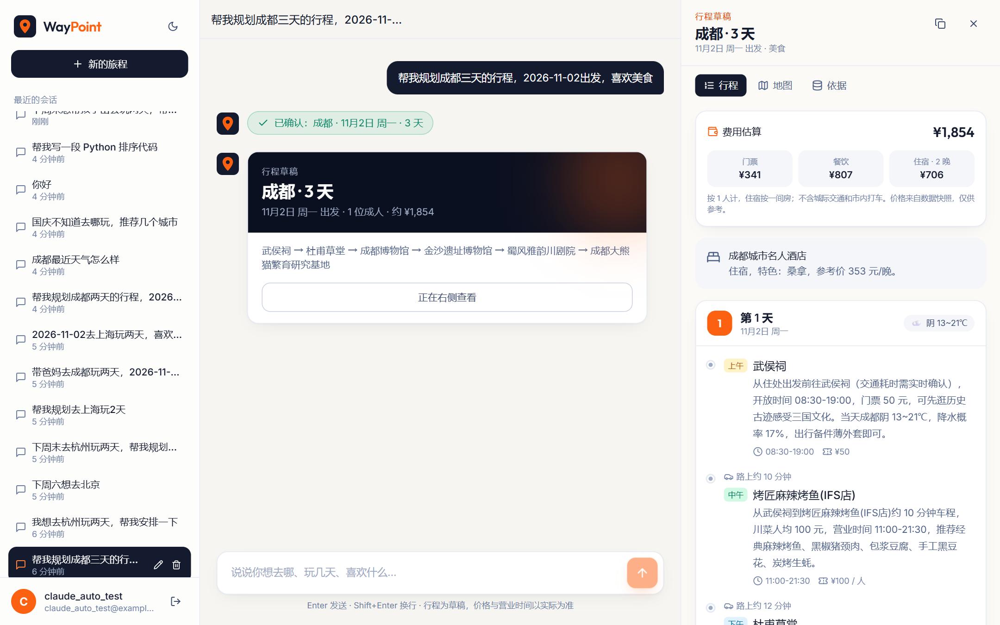
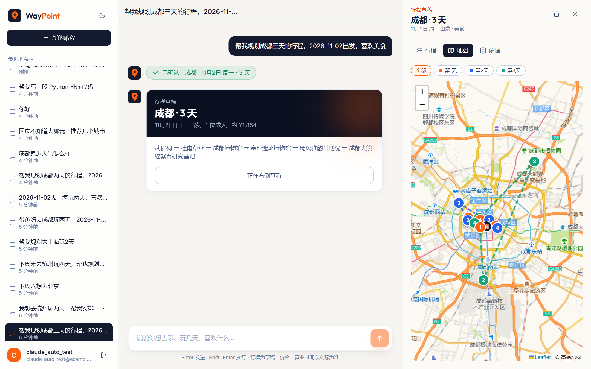
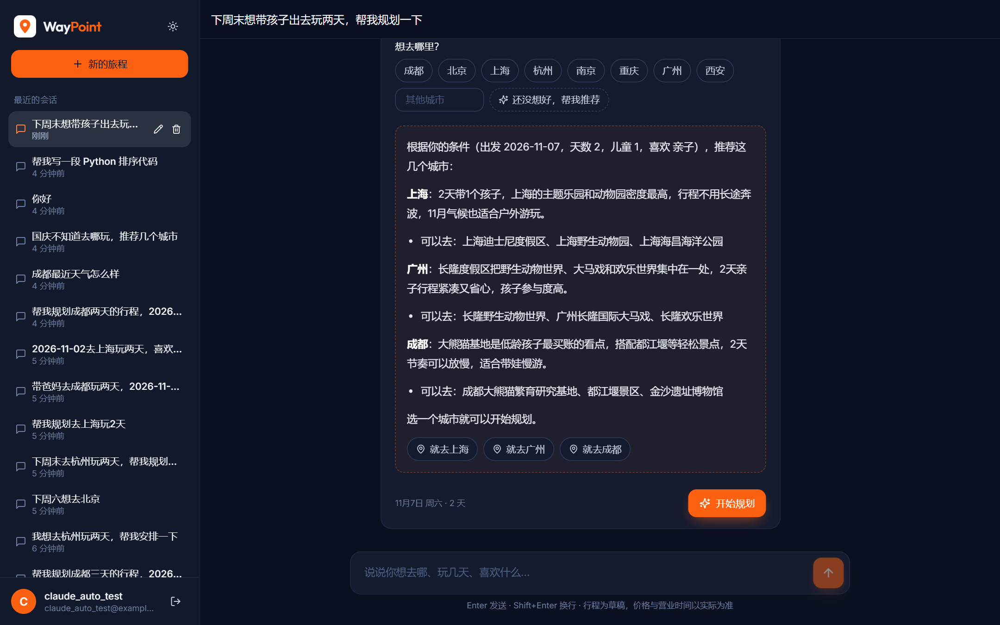
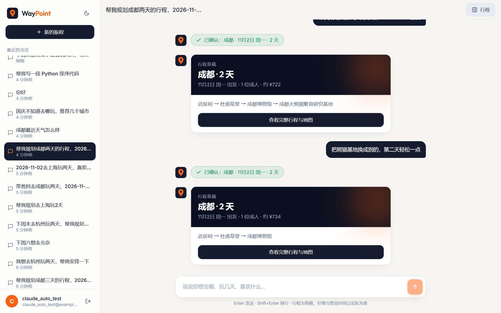
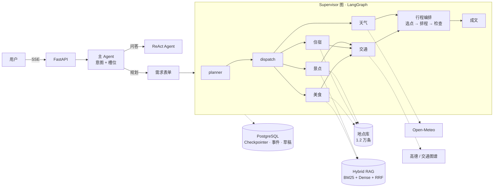

# WayPoint · 多 Agent 旅行规划助手

[](https://github.com/freewhiterain/Waypoint/actions/workflows/ci.yml)

> 每一个落脚点，都有依据。

WayPoint 是一个基于 **LangGraph** 的多 Agent 旅行规划系统。用户用一句话说出想去哪、玩几天、喜欢什么，
系统先理解意图、补全缺的信息，再让五个子 Agent 并行研究景点、住宿、美食、天气和市内交通，
最后由「LLM 选点 + 算法排程 + 约束检查」生成一份按真实路程排好的逐日行程，并在地图上画出每天的路线。

核心原则是**确定性优先**：日期、分天、先后顺序、交通耗时、开放时间都由代码算和查，模型只负责理解偏好和写描述，
不编造班次、价格、营业时间或天气。

## 界面预览

| 逐日行程 · 费用估算 | 地图路线 |
| --- | --- |
|  |  |
| **按条件推荐城市（深色模式）** | **看过行程后提修改，重新规划** |
|  |  |

## 功能一览

| 模块 | 说明 |
| --- | --- |
| 对话理解 | 每轮一次 LLM 结构化输出同时给出意图和槽位变化；槽位经代码校验后跨轮累积；无 Key 时退回规则 |
| 问答线路 | ReAct 循环（最多 4 轮工具调用，回答逐字流式输出）：查本地资料、专项研究、估算地点间路程、按地点库价格估算费用 |
| 规划线路 | 表单只问缺的槽位，三项齐全时直接确认；可让 AI 推荐目的地 |
| 多轮修改 | 看过行程后说"把熊猫基地换成别的""第二天轻松一点"，修改意见被结构化成约束（排除地点、按天降低强度）重新规划 |
| 偏好落地 | 喜欢美食 → 每天加一顿上午景点附近的午餐；不吃辣 → 按菜系、店名、推荐菜排除辣味餐厅；默认排除高价位餐厅 |
| 并行研究 | Supervisor 图按依赖分两批：景点 / 住宿 / 美食 / 天气并行，交通等前面的地点出来再算 |
| 行程编排 | LLM 只能按 id 选点 → 算法按交通耗时分天排序 → 检查开放时间和每日路程，违规原因反馈给 LLM 重选（最多 3 轮） |
| 证据治理 | 每条事实带来源、查询时间和置信度；证据不支持的地点整条丢弃，不支持的属性只去掉那一项 |
| 前端 | React 单页应用：流式对话、研究进度、逐日时间线、Leaflet 地图路线、研究依据、深浅色主题 |
| 评测 | 560+ 个单元/集成测试 + 可判定约束检查（环境层/逻辑层）+ 17 个端到端对话场景 + 模拟用户多轮评测 + pass^k 稳定性 + GitHub Actions |

## 架构



### 一次规划的数据流

1. **理解**（`app/services/main_agent.py`）：模型返回 `TurnUnderstanding`（意图 + 槽位变化）。
   `app/services/slots.py` 校验每个值是否有依据：目的地必须是用户说过的或接受的推荐，"国庆"不会被换算成日期，
   天数必须有"数字 + 时间单位"作依据。
2. **研究**（`app/agents/supervisor.py` + `app/agents/subagents/`）：地点库覆盖的 10 个城市直接取结构化候选
   （名称、坐标、开放时间、价格原样带上，不经过模型）；其他城市先检索证据再让模型做结构化分析。
3. **交通**：景点、住宿、餐厅两两配对算耗时，数据来源依次为交通图谱 → 高德 → 坐标直线距离 → 同区/跨区粗估，
   高德结果写回图谱；没有真实数据时不编分钟数。
4. **编排**（`app/agents/itinerary_planner.py`）：参考 ItiNera（LLM 理解偏好、算法保证顺路）和
   LLM-Modulo（外部检查器把关）。不想去的地点从候选里去掉，轻松日只排 1 个景点；选点不够时从没选中的候选里
   给空时段补一个顺路的景点；喜欢美食的行程在上午景点附近排午餐。
5. **成文**：模型在排好的模板上改写描述，地点、时段、耗时、营业时间、价格一律以模板为准。

## 快速开始

### 1. 依赖

- Python 3.11+、Node 18+、Docker Desktop
- 本地 [Ollama](https://ollama.com/)（Embedding 用，不需要外部 Key）

```powershell
python -m venv .venv
.venv\Scripts\python.exe -m pip install -e ".[dev]"
ollama pull qwen3-embedding:4b
```

### 2. 配置

复制 `.env.example` 为 `.env`，至少填写：

```
LLM_API_KEY=sk-...                    # 任意 OpenAI 兼容接口，默认 DeepSeek
JWT_SECRET_KEY=一段独立的随机字符串
ENABLE_EXTERNAL_TOOLS=true            # 打开后才会查天气、高德、联网搜索
AMAP_API_KEY=...                      # 可选：地点间真实耗时
TAVILY_API_KEY=...                    # 可选：深入研究时联网搜索
```

`LLM_DISABLE_THINKING` 保持 `true`：DeepSeek 的 thinking 模式不支持强制 `tool_choice`，而结构化输出依赖它。

### 3. 一键启动（Windows）

```powershell
start.bat
```

脚本会拉起 PostgreSQL（pgvector）和 Redis 容器、初始化数据库、首次运行时构建前端，然后启动后端并打开
http://localhost:18000/ui/ 。API 文档在 http://localhost:18000/docs 。

### 手动启动

```powershell
python scripts/init_db.py          # 业务表、Checkpointer、Store、pgvector
python scripts/test_llm.py         # 验证模型连接和结构化输出
cd web; npm install; npm run build; cd ..
python app/run.py
```

前端开发：`cd web && npm run dev`，访问 http://localhost:5173/ui/（`/api` 自动代理到 18000）。

## 测试与评测

```powershell
python -m pytest -q                       # 单元 + 集成测试（默认跳过需要真实模型和网络的用例）
python scripts/eval_dialogues.py          # 端到端对话评测，需先启动服务
python scripts/eval_dialogues.py --no-plan  # 只看路由和表单预填，不跑规划
python scripts/eval_dialogues.py --repeat 3 # 每个场景跑 3 次，报告 pass^3
python scripts/eval_simulated_users.py      # 模型扮演用户的多轮对话评测
```

评测分三层，思路来自 [ChinaTravel](https://arxiv.org/abs/2412.13682)（ICLR 2026）和 [τ-bench](https://github.com/sierra-research/tau-bench)：

| 层 | 工具 | 测什么 |
| --- | --- | --- |
| 可判定约束 | `app/evaluation/plan_checks.py` | 对结构化行程做程序判定。**环境层**：地点、门票价、营业时间能在地点库对上，描述里写的价格和营业时间与字段一致（防止随口编价）。**逻辑层**：天数和日期、跨天不重复、必去/不去的地点、轻松的天、每天有晚饭、时段落在营业时间内 |
| 固定台词场景 | `scripts/eval_dialogues.py` | 17 个多轮场景：完整槽位、缺日期、多轮补充、出发地、必去地点、夜景、带老人、中途改目的地、规划后再修改、问答、推荐、闲聊、越界。报告交付率 DR、环境通过率 EPR、逻辑通过率 LPR、最终通过率 FPR |
| 模拟用户 | `scripts/eval_simulated_users.py` | 每个场景只给模型一个隐藏目标和说话风格（话少、先寒暄、中途改主意、日期后补），台词现编。判定能否进入规划、需求是否理解对、行程是否过检查 |

模型输出有随机性，单次通过不代表稳定：`--repeat N` 报告 pass^N（N 次全过的场景占比），并列出时好时坏的场景。
调优流程按 [error analysis](https://hamel.dev/blog/posts/evals-faq/why-is-error-analysis-so-important-in-llm-evals-and-how-is-it-performed.html)
的做法：读失败的完整对话（`logs/*.json`），找第一个出错的环节，归类计数，先修最常见的一类，并把它固化成单元测试。

## 项目结构

```
app/
├── api/           FastAPI 路由：只做鉴权、归属校验和响应封装
├── services/      业务流程：一轮对话（chat_flow）、表单提交与规划（trip_form）、
│                  主 Agent（意图 + 槽位）、ReAct 问答、需求抽取（requirements）、行程渲染（plan_render）
├── agents/        Supervisor 图、五个子 Agent、行程编排、交通耗时、交通图谱
├── core/          LLM 工厂、Checkpointer、Store
├── research/      深度搜索子图
├── rag/           文档加载、父子分块、BM25 + Dense + RRF 混合检索、重排、知识图谱
├── places/        地点库读取与候选筛选
├── governance/    任务事件、证据治理、审批、行程草稿、工具调用幂等
├── mcp_core/      MCP 客户端与自建天气/搜索 Server、超时重试熔断
├── memory/        长期偏好与历史行程
├── models/        SQLAlchemy 模型
└── schemas/       Pydantic 契约
web/               React + TypeScript + Tailwind 前端
scripts/           初始化、数据导入、评测脚本
tests/             pytest
data/places/       地点库（ChinaTravel 数据集，CC BY 4.0）
data/documents/    RAG 文档（开发用模拟资料）
```

## 主要接口

- `POST /api/v1/chat/stream/{conversation_id}`：SSE 对话，每轮在这里判断意图、填槽位。
- `POST /api/v1/chat/tools/{call_id}/result`：提交需求表单，触发规划并以 SSE 返回研究进度和行程。
- `GET /api/v1/chat/history/{conversation_id}`：会话历史（含表单状态和行程结构化结果）。
- `GET /api/v1/planning/drafts/{conversation_id}`：会话当前的行程草稿。
- `POST /api/v1/planning/tasks`：直接提交结构化需求执行规划。

## 数据来源与边界

- **地点库**（`data/places/`）：北京、上海、广州、深圳、成都、重庆、杭州、南京、苏州、武汉 10 城约 1.2 万条景点、
  餐厅、住宿，来自 [ChinaTravel](https://huggingface.co/datasets/LAMDA-NeSy/ChinaTravel-Sandbox) 静态快照。
- **联网搜索**：Tavily → 自建 SearXNG 降级链（`SEARXNG_URL`），地点库没覆盖的城市靠它找景点和餐厅，结果经证据治理后才进入候选。
- **天气**：Open-Meteo（16 天，免费版仅限非商业用途），高德作备用。
- **路程**：交通图谱（表 `travelroute`）→ 高德 → 坐标估算。
- 没有可用数据源时明确说明查不到；不提供购票、预订、支付等交易功能。

## 技术栈

LangGraph 1.0 · LangChain 1.2 · FastAPI · PostgreSQL 17 + pgvector · Redis · ChromaDB · DeepSeek（OpenAI 兼容）·
Ollama Embedding · SSE · React 18 · TypeScript · Tailwind CSS · Leaflet · Zustand
