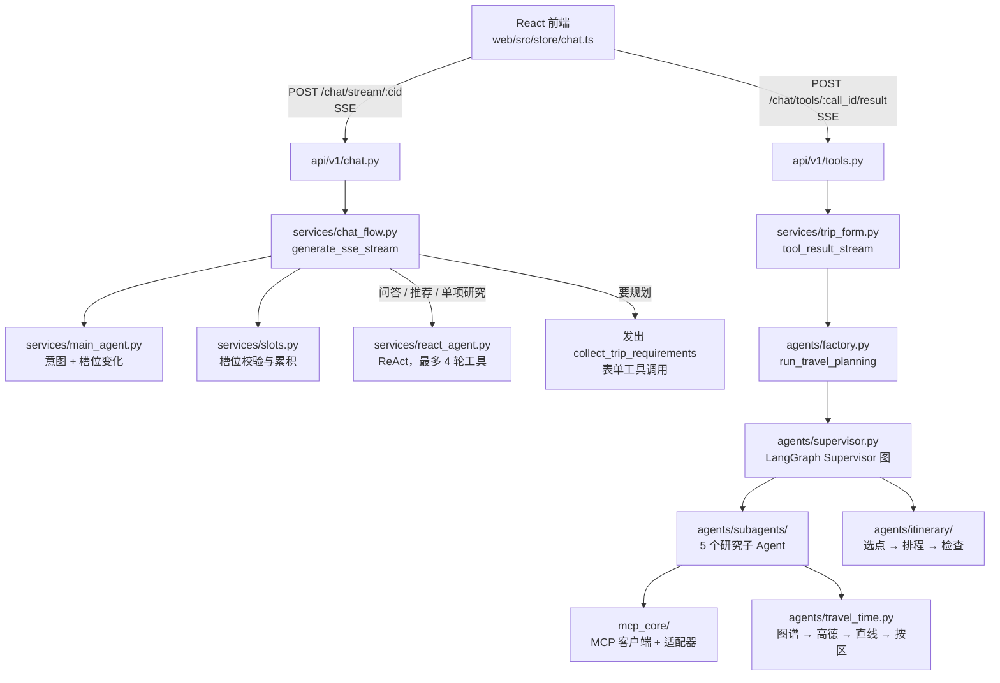
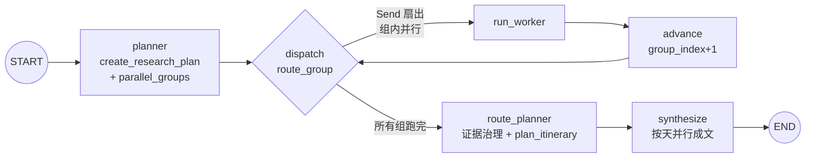
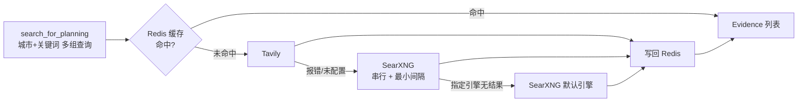

# 系统架构：一条消息从进来到出行程

本文按代码实际执行顺序说明一次对话和一次规划经过哪些模块。文件路径和函数名都能在仓库里直接搜到。

## 1. 总览

路由层（`app/api/v1/*.py`）只做鉴权、会话归属校验和 `StreamingResponse` 封装，流程都在 `app/services/` 里。

## 2. 一轮对话：`chat_flow.generate_sse_stream`

入口是 `POST /api/v1/chat/stream/{conversation_id}`（`app/api/v1/chat.py`）。它校验会话属于当前用户，第一句话时顺手把会话标题改成消息开头，然后把 `generate_sse_stream` 包成 `text/event-stream` 返回。

`generate_sse_stream` 的步骤：

1. **保存用户消息，取上下文**：读最近 12 条消息（`_RECENT_CONTEXT_LIMIT`）。历史里的整份行程用 `_plan_digest` 压成一行摘要（"已给出行程草稿：成都3天。第1天：…"），既省 token，又让理解模块知道"已经有行程"。如果有行程草稿，再把草稿上下文以 system 消息追加进去。
2. **理解**：`MainAgentService.decide`（`app/services/main_agent.py`）。
   - 有 LLM 时，一次结构化输出调用 `with_structured_output(TurnUnderstanding)` 同时给出 `intent`（plan / research / recommend_destination / open_question / chat）和这一轮的 `slots` 变化。提示词里写了今天的日期和星期、日期换算规则、`must_visit` / `avoid_places` / `relaxed_days` / `budget` 的填写规则。调用失败或返回空时重试一次（`_UNDERSTAND_ATTEMPTS = 2`）。
   - 没有 LLM 或两次都失败时，退回 `_decide_by_rules`：关键词判断意图，正则提取槽位。
   - `_decision_from_understanding` 把意图映射成动作：`collect_trip_requirements`、`invoke_agent_tool`（研究意图且有目的地）、`recommend_destination`、`answer_open_question`、`direct_response`。
3. **填槽**：`apply_slot_update`（`app/services/slots.py`）把模型给的变化并进会话槽位，每个字段要有依据才收下。例如目的地必须是用户这句话里说过的，或是用户接受的推荐城市；换了城市会清空上一个城市的 `must_visit`、`budget`、`avoid_places`、`relaxed_days`。没依据的字段被丢弃并记日志。**填槽每一轮都做，与走哪条线路无关。**
4. **按固定规则路由**：
   - `collect_trip_requirements`：不直接开始规划，而是发出一个 `tool_call` 事件，参数里带 `initial_values`（已有槽位）和 `requirement_context`。调用记录写进 `PostgresToolInvocationRepository`。前端据此弹出表单，只问缺的项。如果用户一句话说了多个城市（`later_cities`），这一份只排第一个城市，并先推一句"排好后说'再规划重庆'"。
   - 问答、推荐、单项研究（`_ROUTE_ONE_ACTIONS`）：有 LLM 时交给 ReAct（`app/services/react_agent.py`，`MAX_TOOL_ROUNDS = 4`）。工具有 5 个：`search_travel_knowledge`、`research_topic`、`recommend_cities`、`estimate_trip_cost`、`estimate_travel_time`。回答逐字推送（`token` + `delta: true`）；如果模型说了半句又转去调工具，就发 `token_reset` 撤回。ReAct 出错时退回下面的固定流程。
   - 没走 ReAct 的单项研究直接调 `run_agent_tool`；开放问题调 `answer_open_question`；闲聊、越界返回模型的 `reply` 或固定话术。

## 3. 提交表单后开始规划：`trip_form.tool_result_stream`

入口是 `POST /api/v1/chat/tools/{call_id}/result`（`app/api/v1/tools.py`），转给 `open_tool_result_stream` 做校验（调用存在、属于该用户、工具名一致、状态允许），再进入 `tool_result_stream`：

- **还没选目的地**（`status == "recommend_destination"`）：调 `recommend_destinations`，只在地点库覆盖的城市里挑，返回候选城市，不规划。
- **表单完成**（`status == "completed"`）：
  1. **认领**：`claim_processing` 拿到一个 2 分钟的处理租约（`PROCESSING_LEASE_TIMEOUT`），后台 `processing_heartbeat` 续租。重复提交时，已完成的直接回放结果（`existing_completion_stream`），处理中的返回处理中状态（`processing_stream`），不会重复跑规划。租约丢失时取消规划，返回 `processing_conflict`。
  2. **合并需求**：`confirm_slots` 写回表单值；`apply_form_notes` 用 LLM 把"还有什么要求"一栏解析成 `SlotUpdate`，但目的地、日期、天数以表单为准（`_FORM_OWNED`）；`build_requirement` 合并成 `TravelRequirement`，表单字段优先，上下文字段导致校验失败时只用表单值。
  3. **跑规划，同时转发研究进度**：规划作为一个 `asyncio` 任务运行；`TaskEventService` 使用 `PublishingEventRepository`，每个事件先写 PostgreSQL，再放进队列，由主循环转成 SSE 帧推给前端。
  4. **落库**：在同一个事务里 `finish_processing` 并写入 assistant 消息（`content` 是 `render_plan_markdown` 渲染的 Markdown，`extra_info` 里存结构化结果）；随后 `save_trip_draft` 保存草稿，下一轮"把熊猫基地换掉"时理解模块能读到上一版行程。草稿保存失败只记日志，不影响返回。
  5. 依次推送 `result`（结构化行程）、`token`（Markdown）、`done`。

`agents/factory.py` 的 `run_travel_planning` 负责组装依赖：建子 Agent 注册表（带地点库），取规划用的 LLM。没有 LLM 时仍能出行程，但结果标成 `status="degraded"`，并带降级原因。

## 4. Supervisor 图（LangGraph）

定义在 `create_supervisor_graph`（`app/agents/supervisor.py`），用 `workflow.compile(checkpointer=...)` 编译，`thread_id` 取本次任务 id。

- **planner**（`app/agents/planner.py`）：`create_research_plan` 固定生成 5 个任务。交通依赖景点、住宿、美食（要等这些地点出来才能算两两路程）。`parallel_groups` 按依赖做拓扑分组，再把没人依赖的任务（天气）挪到最后一批。实际分组是：

  | 批次 | 任务 |
  | --- | --- |
  | 第 1 批 | 景点、住宿、美食 |
  | 第 2 批 | 交通、天气 |

  这样天气接口慢的时候不会拖住交通（CHANGELOG 记录研究阶段因此少等约 6 秒）。
- **dispatch / run_worker / advance**：`route_group` 对当前组的每个任务发一个 `Send("run_worker", ...)`，组内并行。传给 Worker 的 `worker_results` 只包含它依赖的任务结果。`worker_results` 字段用自定义 reducer `merge_worker_results`，并行写入时按 task id 合并。Worker 节点调用 `registry.run`，把返回结果过一遍证据治理再存入状态。异常时记为 `failed`，不中断整张图。每一步都会发 `worker_started` / `worker_completed` / `evidence_collected` 等事件。
- **route_planner**：对所有子 Agent 的原始响应再统一做一次证据治理（`EvidenceGovernanceService.review`），然后调用 `plan_itinerary`（见 [planning-engine.md](planning-engine.md)）。LLM 选点就发生在这个节点。
- **synthesize**：`synthesize_itinerary_with_llm` 每天一次 LLM 调用，几天并行（`asyncio.gather`）。模型只输出每个时段的描述（`_LLMItinerary`），`_merge_day` 再把描述合回模板：时段序列和模板对不上的那一天整体用模板；`align_stated_facts` 把描述里写的"门票/人均 X 元"和营业时间改回字段里的值。每天最多尝试两次，失败的那天用模板。最后 `assemble_draft` 汇总证据和告警；有子 Agent 是 `partial`/`unavailable`/`failed` 时，草稿标成 `degraded`。

## 5. 五个研究子 Agent

公共逻辑在 `DomainSubagent.run`（`app/agents/subagents/base.py`），注册在 `create_default_subagent_registry`。

| 子 Agent | 数据来源（按顺序降级） | 特殊处理 |
| --- | --- | --- |
| 景点 `attractions` | 地点库 → `local_rag` → `search_mcp` | 联网搜索时按兴趣、必去地点多搜几组 |
| 美食 `food` | 地点库 → `local_rag` → `search_mcp` | |
| 住宿 `hotel` | 地点库 → `local_rag` → `hotel_mcp` → `search_mcp` | |
| 天气 `weather` | `weather_mcp` → `weather_fallback_api` | 每条预报原文直接作为一条 claim，不让模型转述 |
| 交通 `transport` | 规划时用前一批的候选算两两路程；单独问交通时走 `transport_mcp` → `search_mcp` | 每类只取前几个候选（景点 10、住宿 2、美食 5），避免组合爆炸 |

`DomainSubagent.run` 的流程：

1. **地点库优先**：景点、美食、住宿在地点库覆盖的城市（10 城）直接调 `catalog.shortlist` 取结构化候选。名称、坐标、开放时间、价格原样带上，不经过检索和模型（`_catalog_response`）。
2. **按 `provider_order` 降级**：依次调用数据源，某个数据源报告证据充分（`sufficient`）就停止；证据按 `(id, url, content)` 去重。
3. **冲突与补搜**：`detect_fact_conflicts` 发现数据源之间说法矛盾、用户明确要求深入研究，或证据不足时，在工具策略允许的情况下跑 Deep Search（`app/research/deep_search.py`）补证据。
4. **分析与落地校验**：模型（或没有 LLM 时的确定性分析）给出 claims 和 candidates，`_ground_analysis` 逐条核对：
   - claim 引用的证据 id 不存在，或文字得不到证据支持 → 整条丢弃；
   - 候选名不像地名（`looks_like_place_name`：带"攻略""必去""——"之类）或名字对不上证据 → 整条丢弃；
   - 地点是真的、但描述/价格/属性里有证据没有的内容 → 只去掉那一项，保留地点。

## 6. MCP 与外部工具（`app/mcp_core/`）

- **MCP 客户端**：`MCPClientManager`（`client.py`）是进程内单例，用 `langchain_mcp_adapters` 的 `MultiServerMCPClient` 连接配置了 URL 的天气、搜索 Server（transport 为 `streamable_http`）。`get_allowed_tools` 按白名单只放出只读工具：`get_weather`、`get_transport`、`search_hotels`、`get_hotel_availability`、`web_search`。
- **自建 Server**：`servers/weather_server.py`（高德天气）和 `servers/search_server.py`（Tavily，端口 9002），用 FastMCP 实现，返回带来源和有效期的 Evidence。
- **工具组装**：`build_subagent_tools`（`app/agents/subagents/tools.py`）把 MCP 工具映射到数据源名，并补上非 MCP 的工具：
  - 没部署搜索 MCP 时，直接用搜索适配器顶上 `search_mcp` 这一位置，否则库外城市拿不到任何候选；
  - `local_rag` 把文档检索和知识图谱的证据合并（文档在前）；
  - `weather_fallback_api` 用 `CombinedWeatherAdapter`：Open-Meteo（16 天，带降水概率）为主，查不到时退回高德；
  - `deep_research` 用搜索适配器做多查询研究。
- **可靠性**：`ResilientExecutor`（`reliability.py`）包住所有外部只读调用：
  - 先查缓存再查熔断，上游挂了仍能返回没过期的缓存；
  - 同一个 key 正在请求时复用这次请求（in-flight 去重）；
  - 单次超时，失败重试，退避 `0.1 × 2^n` 秒、最多 1 秒；
  - 连续失败 3 次熔断 30 秒；
  - 缓存最多 512 条，先清过期的，再按到期时间淘汰。

## 7. 联网搜索：降级与缓存（`adapters/search.py`）

- `default_search_adapter` 按配置组装 `FallbackSearchAdapter([Tavily, SearXNG])`，前一个报错（未配置、额度用完、超时）就换下一个，都失败才抛错。
- `RedisSearchCache`：key 是查询的 SHA1，TTL 取 6 小时和证据 `valid_until` 中较早的一个，不足 60 秒就不存。Redis 不可用时跳过缓存，60 秒后再试。CHANGELOG 记录：西安第二次规划从 105 秒降到 27 秒。
- `SearxngSearchAdapter`：进程内串行，两次请求之间至少隔 `searxng_min_interval_seconds`，避免并发请求触发上游验证码；指定的引擎没有结果时退回默认引擎。
- `search_for_planning`（`subagents/tools.py`）：规划时把查询改写成"城市 + 关键词"的几组（如"西安 必去景点 推荐"），景点和美食再给用户点名的地点各搜一次，景点再按第一个兴趣搜一次。多组查询时只保留来源或正文里提到目的地的结果，按 URL 去重。

## 8. 地点间交通：图谱 → 高德 → 估算

`TravelTimeService.compute`（`app/agents/travel_time.py`）对所有地点两两配对，按顺序询问数据源；前一个答不上的地点对交给下一个，某个数据源抛异常就跳过它：

| 顺序 | Provider | 给出什么 |
| --- | --- | --- |
| 1 | `RouteGraphProvider` | PostgreSQL 交通图谱（`travelroute` 表），只用 30 天内的数据 |
| 2 | `AmapRouteProvider` | 高德"距离测量"驾车耗时；需 `ENABLE_EXTERNAL_TOOLS` 且配置 `AMAP_API_KEY` |
| 3 | `StraightLineProvider` | 两地都有坐标时给直线公里数，**不给分钟数** |
| 4 | `DistrictEstimateProvider` | 只判断同区 / 不同区 / 未知，**不给分钟数** |

高德 provider（`app/agents/route_graph.py`）的细节：

- 先补坐标：已有的直接用，其次查图谱缓存，再用高德 POI 搜索定位；
- 按终点分组，一次请求带上所有起点；
- 用 `asyncio.Semaphore(3)` 限制最多 3 个并发请求，失败的等 1 秒重试，共 3 次；
- 结果写回图谱，下次同一城市直接命中。

CHANGELOG 记录：武汉 10 个景点 45 段从 12.4 秒降到 3.7 秒。

交通子 Agent 把每一段写成一条带来源的证据和一个 `travel_leg` 候选，照常经过证据治理。没有真实分钟数时不编数字，具体怎么估算远近见 [planning-engine.md](planning-engine.md#travel-距离怎么算)。

## 9. SSE 流到前端

- 帧格式：`app/api/sse.py` 的 `sse()` 输出 `data: {json}\n\n`。`SSEEventBuilder` 为同一条流生成连续的 `sequence`，研究事件转发时也会重新编号。
- 研究事件只把白名单里的类型转出去（`_PUBLIC_RESEARCH_EVENT_TYPES`，`app/governance/events.py`），payload 不带推理过程和证据原文。

| 事件 | 来源 | 前端用途（`web/src/store/chat.ts`） |
| --- | --- | --- |
| `token`（可带 `delta`） | 回答、提示、行程 Markdown | 追加显示 |
| `token_reset` | ReAct 撤回半句 | 清空已显示的内容 |
| `tool_call` / `tool_result` | 表单调用、ReAct 查资料、单项研究 | `collect_trip_requirements` 弹表单；其余显示查资料过程 |
| `subagent_started` / `subagent_completed` / `subagent_tool_call` / `subagent_tool_completed` / `evidence_collected` / `research_conflict` / `follow_up_search` | 规划中的研究进度 | 五个子 Agent 的进度卡片 |
| `result` | 规划完成 | 逐日时间线、地图、费用 |
| `error` | 异常（带 `code`、`retryable`） | 错误提示 |
| `done` | 每条流结束 | 结束本轮 |

## 10. 关键设计取舍（面试可讲）

- **理解与路由分开**：模型只输出"意图 + 槽位变化"，代码校验槽位、决定走哪条线路。模型说错一个字段只会被丢弃，不会让对话跑到错的流程里。
- **规划要用户确认**：要规划时先发表单，三项槽位齐了、用户提交后才开始跑图。表单只问缺的项。
- **能确定性就确定性**：研究计划、分组、地点库取候选、交通耗时、排程、检查都是代码。规划链路上用到 LLM 的只有这几处：
  - 理解这一轮的意图和槽位；
  - 解析表单"补充要求"；
  - 库外城市的子 Agent 分析检索结果（之后还要过证据校验）；
  - 选点；
  - 成文。

  每一处失败都有重试或规则兜底。
- **数据源层层降级**：地点库 → RAG → MCP / 联网搜索；交通图谱 → 高德 → 直线 → 按区。每一层失败都不让整次规划失败，降级会在结果里标出来。
- **幂等与可恢复**：表单提交有租约和心跳，重复提交回放结果；事件先落库再推送；LangGraph 用 Checkpointer 保存状态。
