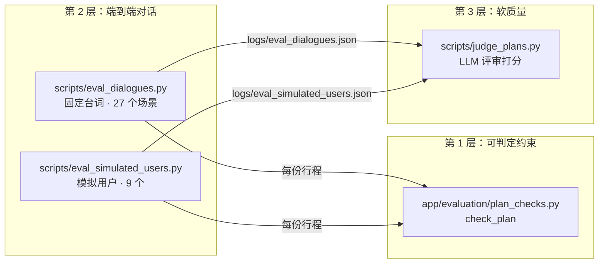

# 评测体系

单元测试保证每个函数按预期工作，但看不出"用户说了这句话，拿到的行程对不对、好不好"。WayPoint 的评测分三层，思路来自 [ChinaTravel](https://arxiv.org/abs/2412.13682)（分层通过率、环境/逻辑约束）和 [τ-bench](https://github.com/sierra-research/tau-bench)（模拟用户、pass^k）：



| 层 | 回答的问题 | 能不能当门槛 |
| --- | --- | --- |
| 可判定约束 | 行程有没有硬错误（编造、重复、违反用户要求） | 能，程序判定 |
| 端到端对话 | 从对话到行程的整条链路能不能交付、稳不稳定 | 能，按分层通过率和 pass^k |
| 软质量 | 行程排得好不好、描述有没有用 | 不能，只用来挑出该人工细看的 |

## 1. 可判定约束：`app/evaluation/plan_checks.py`

`check_plan(requirement, itinerary, catalog, hotel_price)` 对结构化行程（不是 Markdown 文本）做检查，返回 `PlanIssue` 列表，每条带 `environment` 或 `logic` 类别。评测脚本和单元测试共用这一份判定。它导入排程模块的 `SIGHT_PERIOD_WINDOWS`、`same_place`、`_wants_relaxed_trip`，因此评测和排程用的是同一套标准。

**环境层**（行程里的事实是不是编的）：

- 地点库覆盖的城市里，每个地点都要能在库里找到（`catalog.find`）；
- 费用和库里的价格差不超过 1 元；
- 营业时间和库里一致；
- 描述正文里写的"门票/人均 X 元"和营业时间要与结构化字段一致（括号里顺带提到的别处不算），防止"文字里随口编个价"骗过检查。参照 ChinaTravel 的做法。
- 库外城市靠联网搜索，没有可对照的真值，**不做地点库比对**，只做描述一致性检查。

**逻辑层**（是否满足用户约束和常识）：

- 天数、每天的日期；
- 跨天不重复去同一处（餐厅和景点分开比，用 `same_place` 识别别名）；
- 用户说不去的地点没出现；
- 时段落在营业时间内：景点用排程同一份标准；午饭要 12:00~12:30 营业；晚饭 18:00~19:00；夜间 20:00~20:30；
- 吃饭路上不超过 60 分钟（排程超过 45 分钟就换，评测只抓明显不合理的）；
- 每天有晚饭；多天行程里没有整天空白的日子；
- 乐园那天不再排别的景点；要求轻松的天最多 1 个景点；
- 点名的地点都在行程里；
- 有预算时 `estimate_trip_cost` 不超预算。

## 2. 固定台词场景：`scripts/eval_dialogues.py`

对着**正在运行的服务**，用真实 HTTP + SSE 跑多轮对话：登录 → 新建会话 → 逐句发送 → 拿到表单就按场景补齐并提交 → （可选）看完行程再提修改，重新提交 → 断言。

**场景**：`scenarios()` 当前定义了 27 个（CHANGELOG 里的 16、17、19 是当时的场景数，后来又加了一些），覆盖：

- 规划类：完整槽位、缺日期、多轮补充、"下周末"日期换算、出发地、中途改目的地、不吃辣、博物馆偏好、夜景、必去地点、紧预算、带老人要轻松；
- 修改类：规划后换地点、加一个地方、改天数；
- 多城市：先排第一个城市，再接着排第二个；
- 问答类：天气、要花多少钱、预算够不够、值不值得去、城际怎么走、要不要预约、特色菜；
- 其他：推荐目的地、闲聊、越界。

每个 `Scenario` 声明：

- `expect_route`：最后一轮应该弹表单（`tool_call`）还是直接回答（`token`）；
- `expect_prefill`：表单预填里必须有的键值；
- `fill`：表单缺项时补什么；
- `must_contain` / `must_not_contain`：最终输出里必须有、不能有的文字；
- `revise`：拿到行程后说的修改意见。

**失败分三类**（`LAYERS = ("delivery", "environment", "logic")`）：

- **delivery**：路由不对、预填不对、表单缺项无法提交、规划报错、退回规则选点（输出里出现"智能选点暂时不可用"）、没有结构化行程、行程里没有任何具体地点；
- **environment / logic**：`check_plan` 的结果，加上场景的文字断言和质量底线（`plan_quality_failures`：不能出现"没有第二个带证据的景点候选"，晚餐人均不超过 400 元）。

有修改轮次时只按**最后一版**判定 environment 和 logic，上一版的问题改掉了才算修改生效。

**指标**（`summarize`）：

| 指标 | 定义 |
| --- | --- |
| pass@1 | 所有场景单次运行的通过率 |
| DR（交付率） | 规划场景中 delivery 层通过的比例 |
| EPR（环境通过率） | 已交付且 environment 层通过的数量 / 规划场景数 |
| LPR（逻辑通过率） | 已交付且 logic 层通过的数量 / 规划场景数 |
| FPR（最终通过率） | 三层全通过的数量 / 规划场景数 |
| pass^N | `--repeat N` 时，N 次**全部**通过的场景占比（参照 τ-bench），同时列出"时好时坏"的场景 |

模型输出有随机性，单次通过不代表稳定，pass^N 才说明"每次都靠得住"。完整输出写到 `logs/eval_dialogues.json`，用于错误分析。

## 3. 模拟用户：`scripts/eval_simulated_users.py`

固定台词测的是"这句话进来、那份行程出去"。真实用户会一点点透露信息、先寒暄、中途改主意。这个脚本让模型（`temperature=0.8`）扮演用户：每个 `SimulatedUser` 只给一个自然语言目标（`goal`）和说话风格（`persona`），台词由模型现编，所以每次对话都不一样。

**9 个用户**：

| 用户 | 测试点 |
| --- | --- |
| 南京，话少 | 必去中山陵 |
| 广州，一家人 | 第一句不说去哪；不吃辣 |
| 北京，带父母 | 先寒暄；要轻松 |
| 重庆，情侣 | 日期和点名景点后补 |
| 先杭州后改苏州 | 中途改主意 |
| 西安 | 地点库外的城市 |
| 成都 | 看完行程后提修改 |
| 上海，学生 | 有预算 |
| 杭州 | 日期后补 |

**流程**：

1. 最多 `MAX_TURNS = 6` 轮内要弹出规划表单；
2. 表单按目标提交（相当于用户在表单里把错的改对）；预填错了记一条理解问题。但用户还没说到正确目的地时（比如正要从杭州改苏州），预填成杭州不算错；
3. 用另一次 LLM 调用模拟"还有什么要求"一栏：只写目标里有、对话里还没说过的内容；
4. 有 `after_plan` 的用户看完行程再说一句修改意见，以改完的那版判定。

**判定**（全部通过才算成功）：

- 交付：进入了规划并拿到结构化行程；
- 理解：最终需求里的目的地、天数、出发日期和目标一致，点名的地点、忌口、预算都记下了；修改后不想去的地点没了，要轻松的天记下了；
- 行程：过 `check_plan` 的环境层和逻辑层。

指标与固定场景共用 `summarize`（DR/EPR/LPR/FPR、`--repeat N` 的 pass^N），日志写到 `logs/eval_simulated_users.json`。

## 4. 软质量评审：`scripts/judge_plans.py`

检查器只判对错，判断不了"一天里从城东跑到城西再回来""描述空洞""和兴趣不搭"。这个脚本读评测日志，用模型（`temperature=0`）按固定量表逐项打 1~5 分并写一句理由，按总分从低到高列出。

| 类型 | 量表 |
| --- | --- |
| 行程（`RUBRIC`） | route 路线、pace 节奏、fit 贴合、writing 描述 |
| 问答（`QA_RUBRIC`） | answer 回答、grounded 依据、concise 简洁 |

- 从日志里取出每份最终行程（修改过的取最后一版）和每个问答回答；闲聊和越界不评。
- 结构化输出用 `Judgement` / `QAJudgement` 约束，失败重试一次，再失败就跳过这一份。
- 打印每份的总分和低于 4 分的项目及理由，最后给出各项平均分；结果写到 `logs/judge_plans.json`。

**局限**：

- （脚本 docstring 和 README 写明）**分数没有和人工标注对齐过**，所以不作为通过/失败门槛，只用来挑出值得人工读完整对话的行程（参照 Hamel Husain 的做法：先人工标注，确认评分模型和人的判断一致，才能当自动化指标）。
- 评审和被评系统都通过 `app.core.llm.get_llm` 取模型，默认是同一个模型，可能偏向自己的写法；`temperature=0` 能降低波动，但不能消除偏差。
- 量表本身也要校准：CHANGELOG 记录过一次，"贴合"曾因为"用户没说预算/兴趣"扣分，后来在量表里写明"助手不反问，按已知信息评"。
- 评审只看 Markdown 文本和用户说过的话，看不到地点库和真实路程，所以"路线"分是模型的主观判断。真实路程靠第 1 层的检查。

## 5. 怎么跑

先启动服务（`python app/run.py`，默认 `http://127.0.0.1:18000`）。评测账号从 `.env` 的 `AUTO_TEST_USERNAME` / `AUTO_TEST_PASSWORD` 读取，也可以用环境变量 `EVAL_USERNAME` / `EVAL_PASSWORD` 覆盖。`EVAL_BASE_URL` 可以改服务地址。

```bash
python -m pytest -q
```

```bash
python scripts/eval_dialogues.py
```

```bash
python scripts/eval_dialogues.py -k chengdu
```

```bash
python scripts/eval_dialogues.py --no-plan
```

```bash
python scripts/eval_dialogues.py --repeat 3
```

```bash
python scripts/eval_simulated_users.py --repeat 3
```

```bash
python scripts/judge_plans.py
```

```bash
python scripts/judge_plans.py logs/eval_simulated_users.json
```

- `pytest` 跑单元和集成测试（默认跳过需要真实模型和网络的用例）。
- `eval_dialogues.py`：`-k` 只跑名字包含该子串的场景；`--no-plan` 不提交表单，只看路由和预填；`--repeat N` 报告 pass^N。脚本有失败时退出码为 1。
- `judge_plans.py` 默认评 `logs/eval_dialogues.json`，也可以传模拟用户的日志。

## 6. 用评测驱动迭代的方法

README 和 CHANGELOG 里描述的流程（参照 Hamel Husain 的 error analysis）：

1. 跑评测，读失败场景的完整对话（`logs/*.json`）；
2. 找第一个出错的环节，例如理解把"想吃火锅"记进了口味而不是兴趣、排程把乐园和动物园排在同一天；
3. 归类计数，先修最常见的一类；
4. 把它固化成单元测试或新场景，再跑一遍评测确认。

## 7. 已记录的结果（摘自 `CHANGELOG.md`）

以下数字都是 CHANGELOG 里写下的当次结果。评测依赖真实模型和外部服务，本文没有重新运行。

**2026-10-28（下午）评测升级后**

- 固定场景 17 个跑两轮，排除检查器误报后全部通过（DR / EPR 100%）；
- 模拟用户的逻辑通过率从 42% 提到 75%，剩下的失败主要出在模拟器本身，已修正。

**2026-10-30 预算约束与软质量**

- 学生 1500 元预算的模拟用户 0/3 → 3/3；预算固定场景 3/3。
- 第一轮按评审意见修改后：描述 2.7 → 3.2，节奏 3.1 → 3.3。
- 第二轮：路线 2.7 → 3.2；固定场景 19/19、模拟用户 18/18 全部通过。
- 第三轮，模拟用户行程的评审分：

  | 项目 | 修改前 | 修改后 |
  | --- | --- | --- |
  | 路线 | 2.9 | 3.2 |
  | 节奏 | 3.2 | 3.6 |
  | 贴合 | 3.0 | 3.6 |
  | 描述 | 2.9 | 3.2 |

**2026-10-31 拆分模块、问答纳入评审（最新一轮）**

- 问答评审第一轮修复后：回答 3.9 → 4.9，依据 3.4 → 3.9；问答"只答问到的"之后，简洁 3.6 → 约 4.3。
- 这一轮之后，模拟用户行程的评审分：路线 3.1、节奏 3.8、贴合 3.4、描述 3.5；最低总分从 6~8 提到 11（满分 20）。问答回答 5.0、依据 4.0。
- 新增的修改场景（"再加一个地方""改成三天"）首次运行即通过。
- 提速（按事件时间戳拆耗时）：一次规划多数 13~17 秒，慢的时候研究阶段就要 26 秒；高德请求并发后武汉 45 段 12.4 s → 3.7 s；天气挪到第二批后研究阶段少等约 6 秒。

注意：评审分只是相对参考（见第 4 节局限），不同轮次的样本也不完全相同（第二轮起加入了模拟用户的行程），不宜直接当作绝对质量指标。
