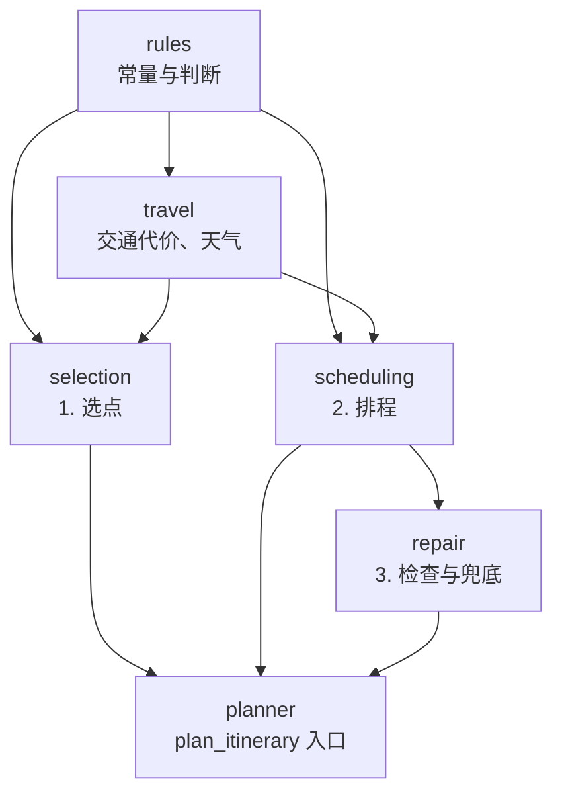
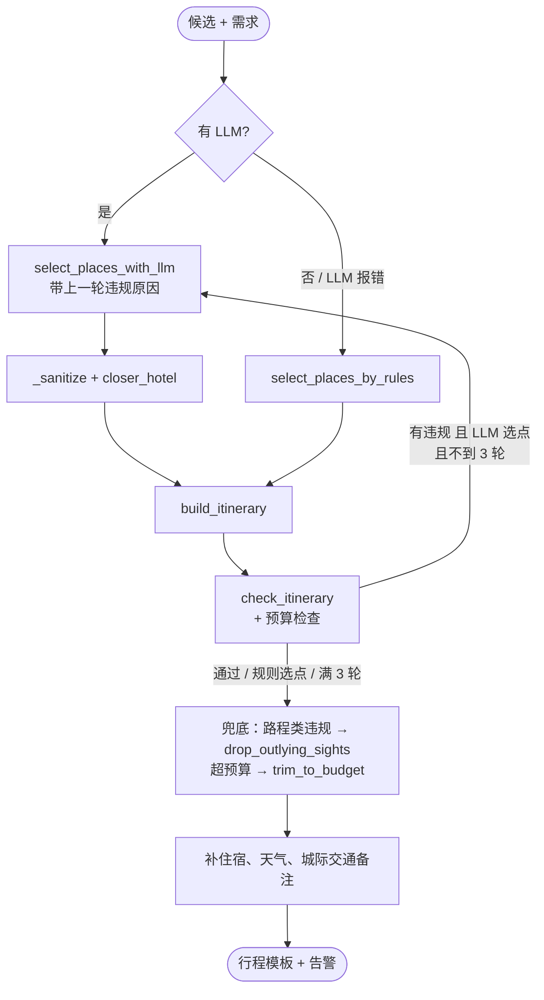

# 行程编排引擎：`app/agents/itinerary/`

Supervisor 图的 `route_planner` 节点调用 `plan_itinerary`。它的输入是 5 个子 Agent 经过证据治理后的候选（景点、餐厅、酒店、交通段、天气），输出是逐日行程的模板。之后 `synthesize` 节点只为模板里的每个时段写描述，不改地点、时段和数字。

## 1. 为什么"确定性优先"

分工参考 ItiNera（LLM 理解偏好，算法保证顺路）和 LLM-Modulo（外部检查器把关，违规原因反馈给 LLM）。具体做法：

| 交给 LLM | 交给代码 |
| --- | --- |
| 从候选里挑哪些景点、餐厅、酒店（只能按 id 选） | 分天、先后顺序、上下午、午饭晚饭、夜景 |
| 为每个时段写描述 | 交通耗时、营业时间、价格、预算、日期 |

这样分的原因都能在代码注释和 CHANGELOG 里找到：

- **事实不能编**：地点、价格、营业时间、耗时来自地点库、高德或坐标计算。模型改写描述时偶尔把人均 70 写成 74，`align_stated_facts`（`app/agents/supervisor.py`）会改回字段里的值。
- **模型不擅长空间优化**：CHANGELOG 记录，"黄浦江 → 临港天文馆 → 回市区吃饭"一天路上三个多小时，模型重选三轮都没改掉，最后由算法兜底解决。
- **输出越短越稳**：早期让模型输出整份行程或带自由文本字段时，工具调用 JSON 经常不合法。现在选点只输出 id，成文只输出描述（见 `PlaceSelection` 和 `_LLMItinerary` 的注释）。
- **可测**：排程规则都是纯函数，能写单元测试；评测脚本用同一份规则判定（`plan_checks.py` 直接导入 `SIGHT_PERIOD_WINDOWS`、`same_place` 等）。
- **没有 LLM 也能出行程**：`select_places_by_rules` 让整条链路在无 Key 环境下也能跑通。

## 2. 模块划分

依赖只往下走（CHANGELOG 记录拆分时用 AST 脚本检查过）：

| 模块 | 内容 |
| --- | --- |
| `rules.py` | 常量；同一处地点（`same_place`）、整天地点（`is_full_day` / `is_excursion`）、轻松日（`day_capacities`）、营业时间（`_fits` / `_open_during`）、想吃什么（`wants_lunch` / `wanted_dishes`） |
| `travel.py` | `TravelCosts`：地点间代价和展示用耗时；按日期取天气、降水概率 |
| `selection.py` | LLM 选点、规则选点、`_sanitize` 清理、`closer_hotel` 换酒店 |
| `scheduling.py` | `build_itinerary`：分天、对调、避雨、上下午、午饭、晚饭、夜景 |
| `repair.py` | `check_itinerary` 检查；`drop_outlying_sights`、`trim_to_budget` 兜底 |
| `planner.py` | `plan_itinerary`：串起上面所有阶段 |

## 3. 主循环：`plan_itinerary`

- 最多 `MAX_ROUNDS = 3` 轮。每一轮的违规（`Violation.message`）原样写进下一轮选点提示词："上一版方案未通过检查，请调整：…"。
- LLM 选点抛异常（包括重试 `SELECTION_ATTEMPTS = 2` 次都失败）时，改用规则选点，并记下原因（余额不足、密钥无效等，由 `describe_llm_failure` 生成），前端会提示"智能选点暂时不可用"。规则选点每轮结果都一样，所以不再重试。
- 三轮后仍有违规时由算法兜底：
  - 有 `daily_travel` / `dinner_far` 违规 → `drop_outlying_sights`，**违规条数变少才采用**；
  - 超预算 → `trim_to_budget`。
- 兜底后仍剩下的违规写进告警（`itinerary_constraint:<code>:<message>`），不会悄悄吞掉。
- 最后在第 1 天开头加住宿备注，在每天加天气备注。用户说了出发地时，首末日注明往返，提示去 12306 或航旅 App 查实时班次，不编车次。

## 4. 阶段一：选点（`selection.py`）

**LLM 选点** `select_places_with_llm`：

- 给模型看的候选是摘要：id、名称、描述前 160 字、价格、类型、区域、营业时间、`position`（纬经度）。另附按天的天气和最多 30 条交通段说明。
- 提示词写明的约束：
  - 每天最多 `ATTRACTIONS_PER_DAY = 2` 个景点、1 顿晚饭，景点总数不超过各天容量之和；
  - 主题乐园、远郊景点各占一整天，选了要相应少选；
  - `must_visit` 里的地点有候选就必须选；
  - 有预算时优先选便宜的；
  - 下雨的日子可以用 `preferred_day` 把室内景点指定到那天；
  - 酒店尽量靠近所选景点。
- 输出结构是 `PlaceSelection`：`hotel_id`、`attractions`、`dinners`，每项只有 `id`、简短 `reason`、可选的 `preferred_day`。

**规则选点** `select_places_by_rules`：候选按偏好关键词命中数排序，取够容量；酒店取第一个候选。

**清理** `_sanitize`：

- 丢掉不在候选里的 id，以及重复的地点（包括同一处的不同叫法，见下文 `same_place`）；
- 超出容量的截掉；`preferred_day` 超出天数的清空；
- 酒店 id 无效时置空；
- 模型漏选了用户点名的地点时，补进去，挤掉排在最后的（`_with_must_visit`）。

**换酒店** `closer_hotel`：模型选的酒店到所选景点的平均代价，比最近的那家多出 `HOTEL_DETOUR_MINUTES = 15` 以上，就换成最近的。候选已经按预算筛过，换哪家都住得起。

**候选过滤**（`rules._candidates`）：用户说不想去的（`avoid_places`，名字互相包含即可）直接从候选里去掉。名字带"夜景/夜游/灯光秀"的景点不进白天候选，另由夜间时段安排。

## 5. 阶段二：排程（`scheduling.build_itinerary`）

按代码顺序：

### 5.1 整天地点先定日子

- **主题乐园、大型动物园**（`is_full_day`，按名字识别）独占一天。地点库的建议游玩时长最多写 4 小时，不可靠，所以按名字认。
- **远郊景点**（`is_excursion`）各占一天，判定方式有两种：
  - 有坐标时（`outskirts`）：离"城市中心"直线距离超过 `OUTSKIRTS_KM = 35` 公里。中心取所有候选（景点、餐厅、酒店）坐标的中位数，因为只看景点时远郊一多，中位数会被拉偏；
  - 没坐标时（库外城市）：按名字认几片常见远郊（`_FAMOUS_OUTSKIRTS`：临潼的兵马俑/华清池/骊山、长城、千岛湖、都江堰青城山、峨眉乐山、黄山）。
- **同一片的远郊合在一天**：两个远郊景点代价不超过 `MAX_HOP_MINUTES = 75`，或属于同一片区，就排在同一天（那天最多 2 个）。
- **选哪一天**：优先离行程中间近的日子，**尽量避开第一天**（第一天要赶路）。模型用 `preferred_day` 指定第一天时，如果还有别的空日子也会挪开。
- **那天的容量设为排进去的整天地点数**：市区景点不会被凑进远郊那天。

### 5.2 分天与补位

1. `assign_days`：先放指定了日子的景点；剩下的贪心成组，从离酒店最近的开始，每次补离上一个最近的。离当天已有景点超过 `MAX_HOP_MINUTES` 的不硬塞，留给后面的日子；最后剩下的放进还有空位、增加路程最少的那天。每天内部用 `_best_order` 枚举所有顺序，取从酒店出发总路程最短的（每天只有 2~3 个点，可以穷举）。
2. `top_up_days`：模型选的景点不够填满容量时，从没选中的普通候选里补顺路的（不超过 `MAX_HOP_MINUTES`，跳过已去过地点的别名）。
3. `fill_empty_days`：补完仍有整天空着的，排一个还没去的远郊或乐园，便宜的优先。
4. `regroup_days`：局部搜索，两天之间对调景点，总路程变短就保留，最多 20 次。指定了日子的不动，每天景点数不变。最后每天取路程更短的方向。
5. `dodge_rain`：某天降水概率不低于 `RAINY_CHANCE = 70`%，且另一天至少干 `DRY_MARGIN = 30` 个百分点、容量相同、户外景点更少，两天的景点整组对调。只换日子不换地点，每天内部的顺路关系不变。

### 5.3 上午和下午

`_assign_periods` 根据营业时间把当天两个景点分到上午、下午：

- 时段要求（`SIGHT_PERIOD_WINDOWS`，评测也用这一份）：上午时段要 11:00 前开门、11:30 后才关门；下午时段要 15:00 前开门、15:00 后才关门。
- 顺序对不上营业时间时对调；熊猫基地、动物园、早市（`_morning_best`）尽量排上午。
- 只有一个景点且上午不开门时，放到下午，上午写"自由活动"并说明原因。
- 整天地点的时段描述前加"这里一玩就是一整天，当天不再安排别的景点。"

### 5.4 午饭、晚饭、夜景

- **午饭**（只有 `wants_lunch` 为真时才排：兴趣里有"美食/小吃/吃"或具体吃食，口味里的具体吃食也算，"不吃辣"这类忌口不算）：`_pick_lunch` 在上午景点 `MAX_LUNCH_MINUTES = 30` 以内、11:30~13:30 营业的餐厅里挑，**当地菜优先，其次看绕路多少**（上午景点 → 午饭 → 下午景点，比直接过去多走的路）。
- **晚饭**：
  - 候选要求 18:00~20:00 营业（午市自助不会被排成晚饭）；
  - `_pick_dinner` 按"最后一站 → 饭店 → 回酒店"整段路程最短挑；
  - 模型选的那家离最后一站超过 `MAX_DINNER_MINUTES = 45`，就换附近的备选；
  - 模型选的用完了，从其余候选里就近补，不会连吃同一家；
  - 吃过一家后，同一连锁的其他分店（括号外名字相同）也算吃过；
  - 作为景点去过的同名地点（如西安"回民街"）不再当饭店排。
- **夜景**：兴趣里有夜景、夜游等词时，晚饭后在 `MAX_NIGHT_MINUTES = 45` 以内排一个夜景点。白天去过的同一段体验（`_SAME_EXPERIENCE`，如黄浦江/外滩、两江游/两江夜游）不再排。
- **后处理**：
  - `ensure_wanted_food`：用户点名想吃的东西（火锅、烤鸭、早茶……）整趟一顿都没有时，把一顿晚饭换成 45 分钟内能吃到的；
  - `limit_foreign_dinners`：用户没点名时，非当地菜的晚饭最多 `max(1, 天数 // 3)` 顿，多出来的换成附近的当地菜。

### 5.5 轻松日

`day_capacities`：默认每天 2 个景点。`relaxed_days` 里的那几天只排 1 个。兴趣或特殊需求里出现"轻松、慢、赶、老人、父母、爸妈"等词时，整趟每天都只排 1 个（`_RELAXED_STYLE_WORDS`；模型常把"爸妈年纪大了别太赶"概括成"带父母"，所以同行长辈本身也算）。

## 6. travel：距离怎么算

`TravelCosts`（`travel.py`）把交通子 Agent 的交通段和候选坐标整理成三种用途：

| 方法 | 用途 | 取值顺序 |
| --- | --- | --- |
| `leg()` | **展示给用户**的一段路 `(分钟, 方式)` | 直线 ≤ `WALK_KM = 1.2` 公里 → 步行，`2 + 公里×15` 分钟（即使有驾车实测也按步行）；否则有实测 → 驾车实测分钟；否则有坐标 → 驾车，`5 + 公里×3.5` 分钟；都没有 → 空 |
| `known()` | 有依据的耗时，用于检查 | 实测分钟 → 坐标估算 → `None` |
| `cost()` | 内部比较远近，**不展示** | `known()`；都没有时按区粗估：同区 20、未知 35、不同区 50 |

成文提示词要求：`walk` 写"步行约 X 分钟"，`drive` 写"约 X 分钟车程"，耗时为空的不提交通。所以没有数据时不会出现编造的分钟数。

**同一处地点** `same_place`：

- 去掉括号里的分店名再比（"四季民福烤鸭店(故宫店)"不算故宫）；
- 去掉城市名前缀和"景区/公园/博物馆/寺"等通用后缀，比主干（灵隐寺 ≈ 灵隐飞来峰景区）；
- 括号里是别名时也算（"秦始皇帝陵博物院(兵马俑)" ≈ 兵马俑）；
- `_SAME_EXPERIENCE` 里列出的名字不同但是同一段体验的，也算同一处。

## 7. 阶段三：检查与兜底（`repair.py`）

`check_itinerary` 产出的违规类型：

| code | 条件 |
| --- | --- |
| `opening_hours` | 上午/下午景点的营业时间不满足 `SIGHT_PERIOD_WINDOWS` |
| `daily_travel` | 当天交通分钟数之和 > `MAX_DAILY_TRAVEL_MINUTES = 180`；或当天景点之间按坐标估算的路程 > 180（防止相隔几十公里的景点同一天） |
| `dinner_far` | 晚饭离上一站 > 45 分钟 |
| `must_visit` | 点名的地点没排进去；候选里有就让模型按 id 选上，查不到资料就明说 |
| `budget` | `estimate_trip_cost`（`app/agents/trip_cost.py`，门票餐饮按人头、住宿按晚，与前端 `web/src/lib/cost.ts` 规则一致）超出总预算 |

兜底算法：

- `drop_outlying_sights`：对路程超标或晚饭太远的那天，去掉"进出路程之和最长"的景点（用户点名的不动），把它加进 `avoid_places`，重新 `build_itinerary`，让算法就近补位。
- `trim_to_budget`：从最贵的开始换，**先换饭，再换门票**，直到不超预算。换上的要比原来便宜、没去过、饭点营业或景点开放、离上一站不远（饭 45 分钟、景点 75 分钟）。用户点名的地点不换。

## 8. 常量一览（`rules.py` / `travel.py`）

| 常量 | 值 | 含义 |
| --- | --- | --- |
| `MAX_ROUNDS` | 3 | 选点 → 排程 → 检查最多几轮 |
| `SELECTION_ATTEMPTS` | 2 | 单次选点的结构化输出重试 |
| `ATTRACTIONS_PER_DAY` | 2 | 每天默认景点数 |
| `MAX_DAILY_TRAVEL_MINUTES` | 180 | 每天路上上限 |
| `MAX_HOP_MINUTES` | 75 | 同一天两个景点之间的上限 |
| `MAX_LUNCH_MINUTES` | 30 | 午饭离上午景点 |
| `MAX_DINNER_MINUTES` | 45 | 晚饭离最后一站 |
| `MAX_NIGHT_MINUTES` | 45 | 夜景离晚饭 |
| `HOTEL_DETOUR_MINUTES` | 15 | 换更近酒店的阈值 |
| `OUTSKIRTS_KM` | 35 | 远郊判定距离 |
| `WALK_KM` | 1.2 | 按步行写的直线距离 |
| `RAINY_CHANCE` / `DRY_MARGIN` | 70 / 30 | 雨天对调阈值 |

## 9. 已知局限（代码里能看到的）

- 每天固定"上午、午饭（可选）、下午、晚饭、夜景（可选）"几个时段，没有精确到钟点的时间表。
- 交通子 Agent 只给前几个候选算路线（景点 10、住宿 2、美食 5），其他地点靠坐标估算或按区粗估。
- 很多判断靠名字关键词：乐园、远郊片区、夜景、辣菜、早上适合去的地点。没有收录的名字识别不出来。
- 一份行程只排一个城市；多城市需要用户说"再规划 X"接着排。
- 城际交通不在规划范围内，只提示去哪里查。
